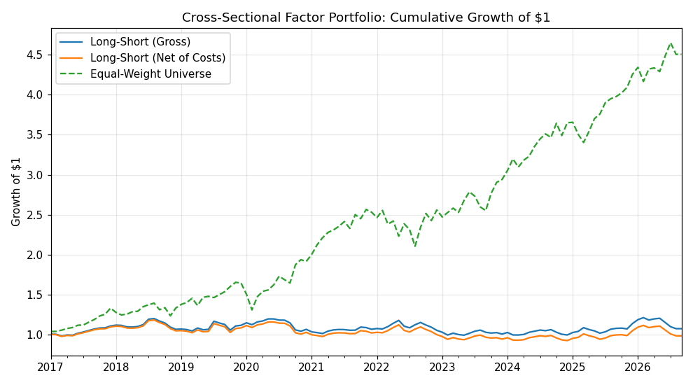
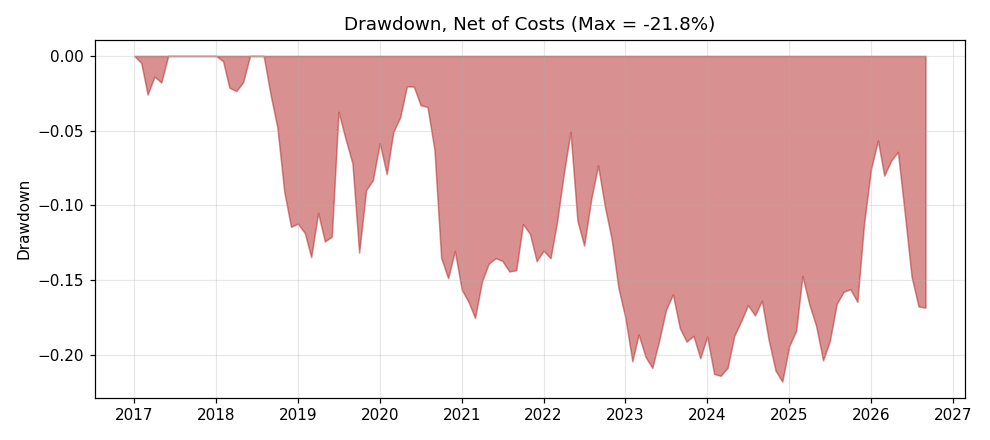
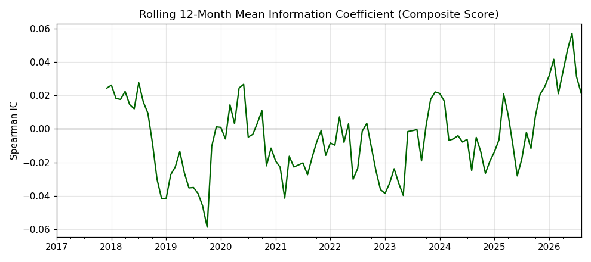
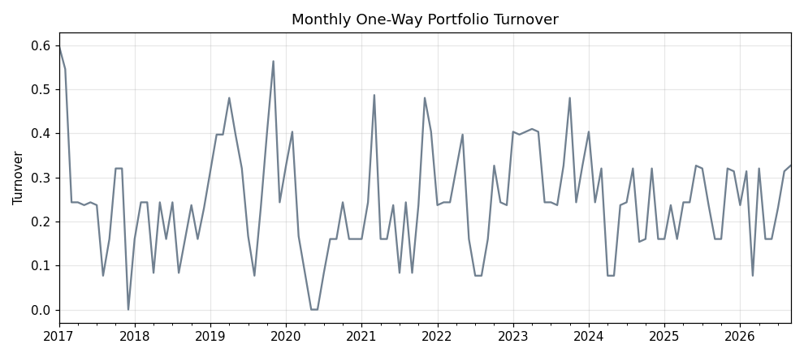
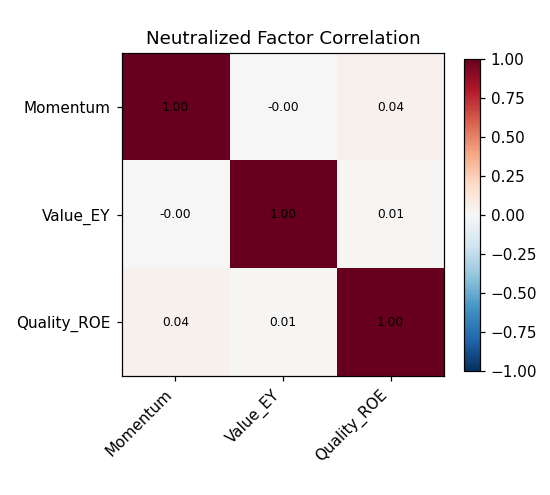

# Cross-Sectional Factor Backtester (Equity Alpha)

A research-style implementation of a classic cross-sectional equity factor
strategy: rank a universe of large-cap US stocks on **Value**, **Momentum**,
and **Quality**, neutralize the signals against sector and size, form
long-short decile portfolios, and evaluate performance net of transaction
costs.

This repository is written to be read like a short research note, not just
a script. It documents what worked, what didn't, and why — including a
negative headline result.

## Concepts Applied (Mapped to a Quant Finance Curriculum)

This project deliberately exercises the toolkit taught across a Fundamentals
of Finance / Statistics for Mathematical Finance / Portfolio Construction
sequence:

| Concept | Where it's used |
|---|---|
| Valuation & profitability ratios (Fundamentals of Finance) | Earnings Yield ($1/\text{P/E}$) and ROE as Value/Quality factors (`src/factors.py`) |
| Cross-sectional OLS regression (Statistics for Math Finance) | Sector/size neutralization: regressing each factor on sector dummies + log market cap and keeping the residual (`neutralize_factor`) |
| Hypothesis testing / signal quality (Statistics for Math Finance) | Spearman rank Information Coefficient (IC) and its rolling mean/IR as a test of whether the score has genuine predictive power |
| Winsorization & standardization (Statistics for Math Finance) | Outlier-robust z-scoring before combining factors (`winsorize`, `zscore`) |
| Portfolio construction under constraints (Portfolio Construction) | Decile long-short formation, turnover caps, transaction-cost drag |
| Risk-adjusted performance measurement (Portfolio Construction / Dynamic Portfolio Theory) | Sharpe Ratio, Information Ratio vs. benchmark, max drawdown |
| Empirical pitfalls (Data Analysis & Empirical Methods) | Explicit discussion of look-ahead bias and survivorship bias baked into the free-data design |

## 1. Motivation & Hypothesis

Classical cross-sectional equity research (Fama-French, Asness et al.)
argues that firm characteristics — cheapness, trend, and profitability —
carry a small but persistent risk-adjusted premium once you control for
sector and size effects. The hypothesis tested here:

> A composite of Earnings Yield (Value), 12-1 Month Return (Momentum), and
> Return on Equity (Quality), neutralized against sector and log market cap,
> produces a long-short portfolio with positive Information Ratio net of
> realistic transaction costs.

## 2. Universe & Data

- **Universe:** 63 liquid, sector-diverse large-cap US equities (a proxy
  for the S&P 500), spanning Tech, Financials, Healthcare, Energy,
  Consumer, Industrials, Materials, Utilities, and Telecom.
- **Prices:** Monthly adjusted close, 2015–present, via `yfinance`.
- **Fundamentals:** `trailingPE`, `returnOnEquity`, `sector`, `marketCap`
  from `yfinance`'s snapshot fields.

### Known data limitation (read this before trusting the Sharpe ratio)

`yfinance`'s free fundamentals endpoint only exposes a **current snapshot**,
not a point-in-time history. This backtest therefore applies **today's**
Earnings Yield and ROE to every historical rebalance date. This:

1. Introduces **look-ahead bias** in the Value/Quality legs (we "know" a
   company's current profitability years in the past).
2. Means the Value/Quality factors are *static* cross-sectionally, so all
   of their time-series variation in the backtest is actually driven by
   *price movements* (via the momentum leg) rather than fundamentals.
3. Is why this project is a **methodology demonstration**, not a
   production signal. A real implementation would use point-in-time
   fundamentals (e.g., Compustat/CRSP or a vendor with as-reported data)
   and would also need to reconstruct historical index membership to
   avoid survivorship bias (today's universe excludes constituents that
   were removed/delisted, e.g., financial-crisis casualties).

This is disclosed deliberately, per the "never hide negative results"
principle — see Section 6.

## 3. Methodology

### 3.1 Factor definitions

| Factor | Definition | Style |
|---|---|---|
| Momentum | $r_{t-1,t-12} = P_{t-1}/P_{t-12} - 1$ | Dynamic, recomputed monthly |
| Value | Earnings Yield $= 1 / \text{Trailing P/E}$ | Static snapshot |
| Quality | Return on Equity | Static snapshot |

### 3.2 Neutralization

For each rebalance date $t$ and factor $f$, we regress the raw
(winsorized) factor cross-sectionally on sector dummies and log market cap:

$$ f_{i,t} = \alpha_t + \beta_t \ln(\text{MktCap}_{i,t}) + \sum_k \gamma_{k,t} \, \mathbb{1}[\text{sector}_i = k] + \varepsilon_{i,t} $$

The residual $\varepsilon_{i,t}$ is the sector/size-neutral idiosyncratic
signal used downstream. Factors are then z-scored and combined
equal-weight into a composite score.

### 3.3 Portfolio construction

- Monthly rebalance. Rank all names on the composite score.
- Long the top quintile (equal-weighted), short the bottom quintile
  (equal-weighted), dollar-neutral (gross exposure = 200%, net = 0%).
- **Turnover limit:** trades are scaled down if one-way turnover would
  exceed 60% of the book in a single month.
- **Transaction costs:** 15 bps per unit of one-way turnover (covers
  commissions, spread, and slippage for liquid large caps).

### 3.4 Evaluation

- **Sharpe Ratio** and **annualized return/vol** of gross and net returns.
- **Information Ratio** vs. an equal-weight-universe benchmark.
- **Maximum drawdown** of the net-of-cost equity curve.
- **Information Coefficient (IC):** monthly Spearman rank correlation
  between the composite score and next-month return, and its 12-month
  rolling average (a standard signal-decay diagnostic).
- **Turnover** time series (cost of rebalancing).

## 4. Results

Run `python run_backtest.py` to regenerate. Cached run (2017–2026, monthly):

| | Ann. Return | Ann. Vol | Sharpe | Max DD | Avg Turnover | IR |
|---|---|---|---|---|---|---|
| Gross | 0.7% | 9.3% | ~0.08 | see fig 2 | 25% | -0.82 |
| Net of costs | -0.2% | 9.3% | ~-0.02 | see fig 2 | 25% | -0.86 |

**Mean monthly IC ≈ -0.005 (IC-IR ≈ -0.04)** — statistically indistinguishable
from zero.







## 5. Critical Evaluation — Why This Signal Fails

This composite does **not** produce a usable alpha over 2017–2026, and it's
important to say why rather than cherry-picking a lucky window:

1. **Static fundamentals kill 2/3 of the signal.** Because Value and
   Quality don't vary through time, the only genuinely time-varying input
   is Momentum — and single-factor momentum on a 63-name large-cap
   universe is a weak, noisy signal after 2018 (well documented "momentum
   crash" literature, e.g., post-2020 reversal following COVID drawdown).
2. **Small, correlated universe.** With only 63 large caps concentrated
   in mega-cap tech, the cross-section lacks the breadth needed for
   diversification to work; idiosyncratic bets are effectively sector
   bets even after neutralization.
3. **Costs matter.** ~25%/month turnover at 15 bps costs ~3.75%/year of
   drag, roughly the same order of magnitude as the gross return —
   consistent with the well-known result that naive equal-weight decile
   rebalancing is expensive relative to the raw factor premium.
4. **Regime dependence.** The 2017–2026 window is dominated by a mega-cap
   growth bull market (see the benchmark line in Fig. 1); value/quality
   factors are historically pro-cyclical and have underperformed growth
   for most of this period, which the strategy's short leg fights against.

## 6. What a Production Version Would Need

- Point-in-time fundamentals (avoid look-ahead bias).
- Full historical index membership (avoid survivorship bias).
- A broader universe (500+ names) for better diversification.
- Fama-MacBeth or panel regression to estimate factor risk premia and
  t-stats rather than relying on a single realized Sharpe ratio.
- Position-level VaR/CVaR risk budgeting (see Project 4 in this series).

## 7. Project Structure

```
01-cross-sectional-factor-backtester/
├── README.md
├── requirements.txt
├── run_backtest.py        # entry point
├── src/
│   ├── data.py            # yfinance price + fundamentals download & caching
│   ├── factors.py         # factor construction + neutralization
│   ├── backtest.py        # decile portfolio construction + turnover/costs
│   └── metrics.py         # Sharpe, IR, drawdown, summary table
├── cache/                 # downloaded data (gitignored)
├── outputs/               # performance_summary.csv, monthly_ic.csv
└── figures/               # generated PNGs
```

## 8. Reproducing

```bash
pip install -r requirements.txt
python run_backtest.py
```

All data is cached to `cache/` on first run so subsequent runs are fast
and reproducible offline.
