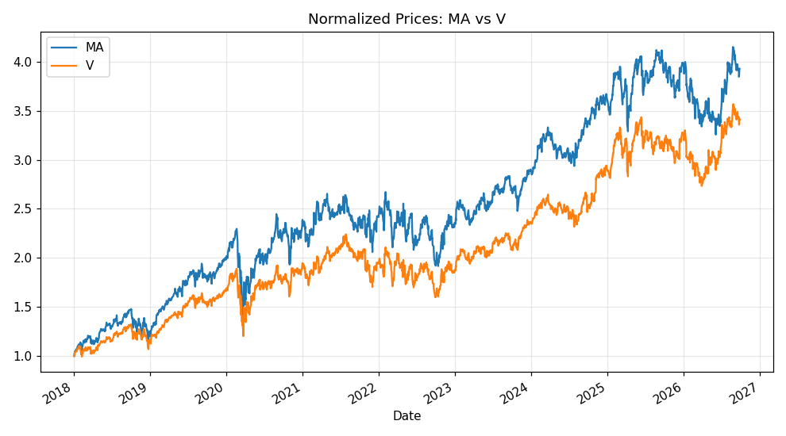
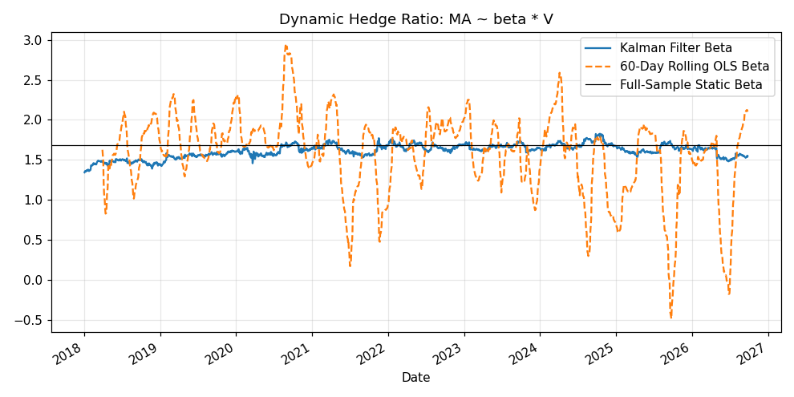
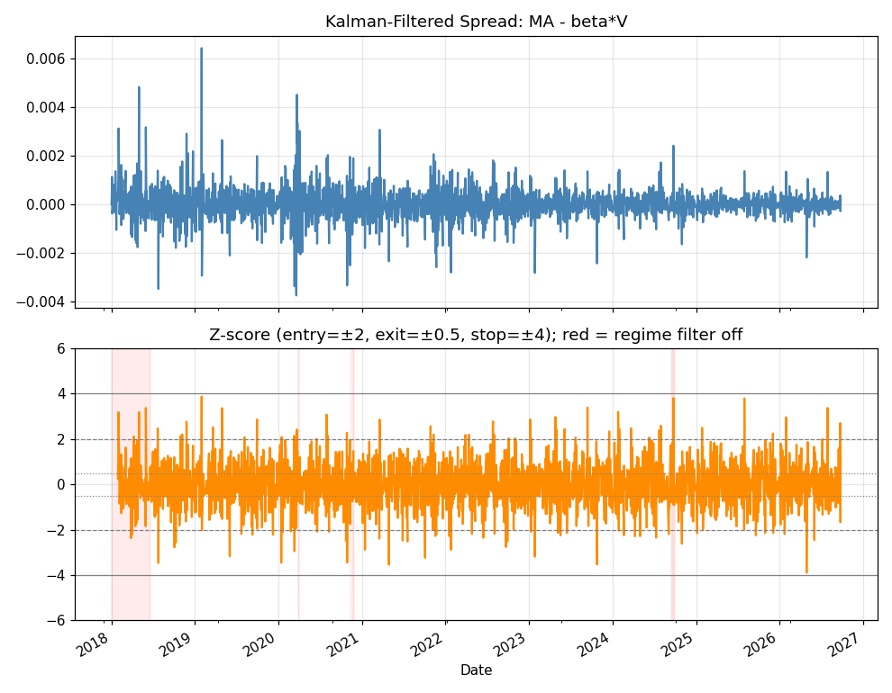
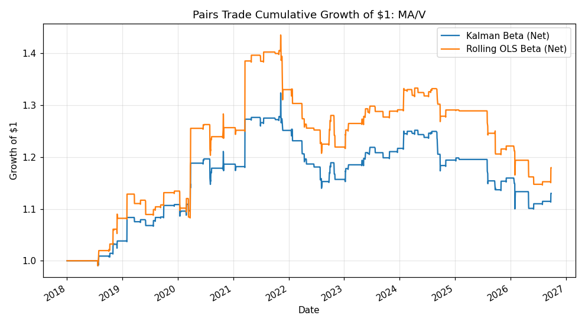
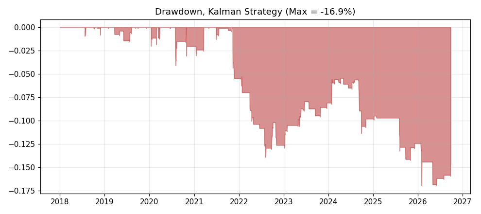

# Statistical Arbitrage & Pairs Trading Engine

A cointegration-based pairs trading engine: screen sector-matched pairs for
mean reversion (ADF + Johansen), fit an Ornstein-Uhlenbeck process to the
spread, estimate a **time-varying hedge ratio** with a Kalman filter, and
trade dynamic Z-score signals with a regime filter and stop-loss.

## 1. Motivation & Hypothesis

Naive pairs trading on price correlation is a well-known trap: two
uncorrelated-in-levels series can be highly correlated in returns yet never
mean-revert (spurious regression, Granger & Newbold 1974). The
academically correct approach is to test for **cointegration** — a
long-run equilibrium relationship whose deviations are stationary — not
mere correlation.

> Hypothesis: among sector-matched candidate pairs, the pair with the
> strongest cointegration evidence exhibits a mean-reverting spread that,
> traded with a dynamically-updated hedge ratio, produces a positive
> risk-adjusted return net of transaction costs.

## 2. Universe & Data

Candidate pairs are chosen from **economically related businesses** first,
then validated statistically (never mine cointegration across arbitrary
tickers — with enough names you will find spurious relationships by
chance, a multiple-testing problem):

| Pair | Sector rationale |
|---|---|
| KO / PEP | Beverages |
| XOM / CVX | Integrated oil majors |
| JPM / BAC | Money-center banks |
| HD / LOW | Home-improvement retail |
| MA / V | Payment networks |
| GS / MS | Investment banks |
| UNP / CSX | Class-I railroads |

Daily adjusted close prices, 2018–present, via `yfinance`.

## 3. Methodology

### 3.1 Cointegration screening

For each pair $(Y, X)$:

1. **Engle-Granger:** static OLS $Y_t = \alpha + \beta X_t + \varepsilon_t$,
   then Augmented Dickey-Fuller test on the residual spread
   $S_t = Y_t - \beta X_t$ for a unit root ($H_0$: not stationary).
2. **Johansen trace test** on the bivariate VECM system as a
   cross-check that doesn't depend on an arbitrary choice of dependent
   variable (Engle-Granger is asymmetric; Johansen is not).

### 3.2 Ornstein-Uhlenbeck fit

The (static-beta) spread is fit as a discretized OU process via AR(1):

$$ S_t = c + \phi S_{t-1} + \varepsilon_t, \qquad \kappa = -\ln(\phi)\times 252, \qquad \theta = \frac{c}{1-\phi} $$

giving a half-life of mean reversion
$t_{1/2} = \ln(2)/\kappa$ — used to sanity check that the reversion speed
is fast enough to trade (multi-year half-lives aren't tradable).

### 3.3 Dynamic hedge ratio (Kalman filter)

Rather than a single historical $\beta$, the hedge ratio is treated as a
latent, slowly time-varying state:

$$ \begin{aligned} \text{state:} \quad & \begin{bmatrix}\alpha_t\\\beta_t\end{bmatrix} = \begin{bmatrix}\alpha_{t-1}\\\beta_{t-1}\end{bmatrix} + w_t, \quad w_t \sim N(0, Q)\\ \text{obs:} \quad & Y_t = \alpha_t + \beta_t X_t + v_t, \quad v_t \sim N(0, R) \end{aligned} $$

updated recursively with the standard Kalman predict/update equations. This
is compared against a 60-day rolling OLS beta as a simpler, more common
baseline.

### 3.4 Signal generation & risk controls

- **Z-score:** rolling 20-day mean/std of the Kalman spread.
- **Entry:** $|z| > 2$. **Exit:** $|z| < 0.5$ (reversion) . **Stop-loss:**
  $|z| > 4$ — if the spread keeps diverging past the stop, the economic
  relationship may be broken (M&A rumor, regulatory shock, earnings
  surprise), so the position is cut rather than "averaged down."
- **Regime filter:** a rolling 120-day ADF test must show $p < 0.10$ to
  **open** a new position (existing positions can still be closed/stopped
  even if the filter turns off). This is a simple proxy for "stand aside
  when the structural relationship looks broken," e.g. around earnings
  dates that temporarily decouple the pair.
- **Transaction costs:** 5 bps per unit of turnover on each leg.

## 4. Results

Run `python run_pairs.py` to regenerate (screens all 7 candidate pairs,
trades the best one). Cached run selected **MA / V** (lowest ADF p-value,
0.0054):

| | ADF p-value | Beta (static) | Johansen trace stat | Cointegrated (95%) |
|---|---|---|---|---|
| MA-V | 0.0054 | 1.68 | see `outputs/cointegration_screen.csv` | No (borderline) |
| XOM-CVX | 0.0120 | 0.90 | | |
| HD-LOW | 0.0131 | 1.26 | | |

OU fit on MA-V spread: half-life ≈ **46 trading days**.

| Strategy | Ann. Return | Ann. Vol | Sharpe | Max DD | Hit Rate |
|---|---|---|---|---|---|
| Kalman beta, Gross | 4.2% | 6.2% | 0.70 | -11.4% | 58.1% |
| Kalman beta, Net of costs | 1.4% | 6.0% | 0.26 | -16.9% | 32.9% |
| Rolling-OLS beta, Gross | 4.9% | 8.0% | 0.63 | -13.7% | 57.4% |
| Rolling-OLS beta, Net of costs | 2.0% | 7.9% | 0.29 | -20.2% | 32.9% |







## 5. Critical Evaluation — Why This Strategy Is Marginal, Not a Free Lunch

1. **Johansen disagrees with Engle-Granger.** The Johansen trace test does
   not confirm cointegration at the 95% level for the top-ranked pair even
   though the Engle-Granger ADF test rejects a unit root at p≈0.005. This
   is a known tension between the two tests in finite samples (Johansen
   is more conservative with only 2 variables and short samples) — the
   honest conclusion is "weak/borderline cointegration evidence," not a
   slam dunk. A production system would require agreement across tests
   or a longer sample before sizing up.
2. **Costs erode roughly 60-70% of the gross Sharpe.** At 5 bps/turnover
   the position trades often enough (mean-reversion strategies are
   naturally high-turnover) that transaction costs are a first-order,
   not second-order, consideration — consistent with the literature on
   pairs trading profit decay since the strategy became crowded
   post-2000 (Gatev, Goetzmann & Rouwenhorst; do, Faff).
3. **Hit rate below 50% net of costs despite positive expectancy.** The
   strategy is a classic "small many wins, occasional larger loss capped
   by stop-loss" profile — a low hit rate is expected and not itself a
   red flag, but it does mean single-pair position sizing must be small
   relative to capital (this is a single pair, not a diversified book).
4. **Single-pair concentration risk.** Trading only the top-ranked pair
   means idiosyncratic risk is not diversified away — a real
   implementation should trade a basket of the cointegrated pairs
   (XOM-CVX, HD-LOW, UNP-CSX also screen well) to smooth returns, at the
   cost of additional complexity in capital allocation.
5. **Kalman vs rolling OLS is a wash here.** The Kalman filter produces a
   smoother beta (see Fig. 2) and marginally better Sharpe/drawdown, but
   the difference is small relative to sampling noise over one pair and
   one sample period — not strong evidence that the extra complexity of
   a Kalman filter is worth it for this specific pair. It's included to
   demonstrate the technique, not because it's proven superior here.

## 6. What a Production Version Would Need

- Trade a diversified basket of cointegrated pairs with a formal capital
  allocation/risk-budget across pairs.
- Require agreement between Engle-Granger and Johansen before sizing up,
  and re-test cointegration periodically (rolling window) to detect
  structural breaks rather than assuming a fixed relationship forever.
- Explicit earnings-date blackout windows rather than a purely
  statistical regime filter.
- Position sizing via the OU half-life and volatility (e.g. size
  inversely to $\sigma/\sqrt{\kappa}$) rather than fixed unit size.

## 7. Project Structure

```
02-statistical-arbitrage-pairs-trading/
├── README.md
├── requirements.txt
├── run_pairs.py            # entry point
├── src/
│   ├── data.py              # yfinance daily price download & caching
│   ├── cointegration.py     # ADF, Johansen, OU process fit
│   ├── kalman.py            # Kalman filter dynamic hedge ratio
│   ├── backtest.py          # z-score signals, regime filter, stop-loss, P&L
│   └── metrics.py           # Sharpe, drawdown, hit rate
├── cache/                   # downloaded data (gitignored)
├── outputs/                 # cointegration_screen.csv, performance CSVs
└── figures/                 # generated PNGs
```

## 8. Reproducing

```bash
pip install -r requirements.txt
python run_pairs.py
```
