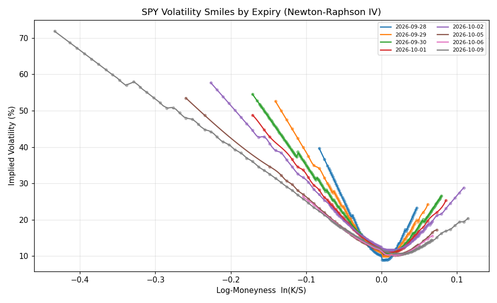
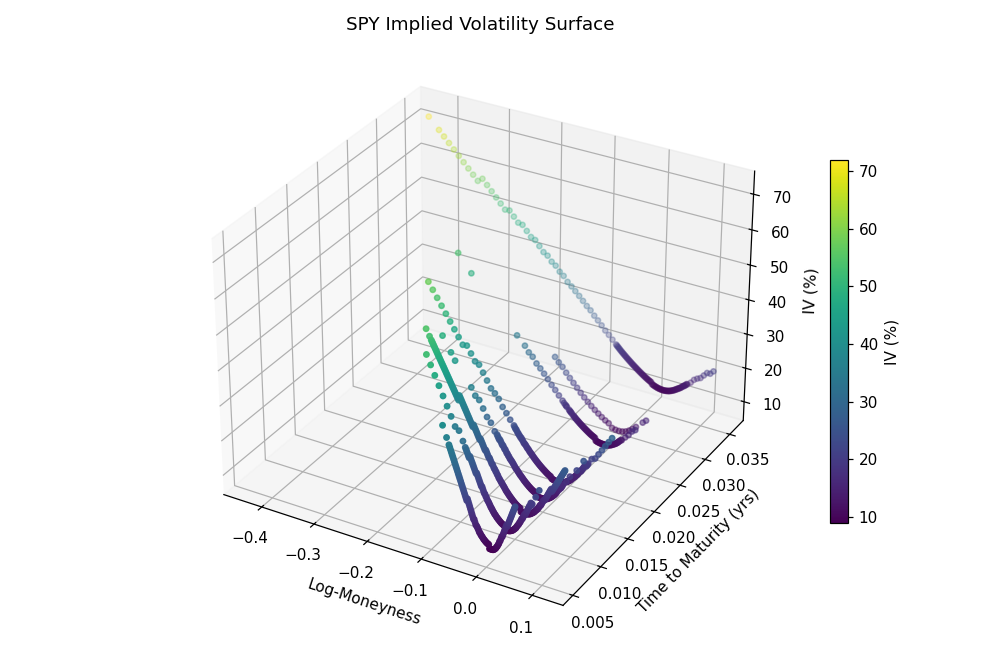
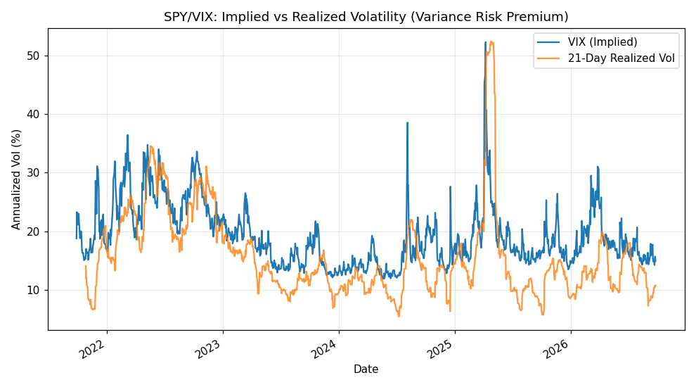
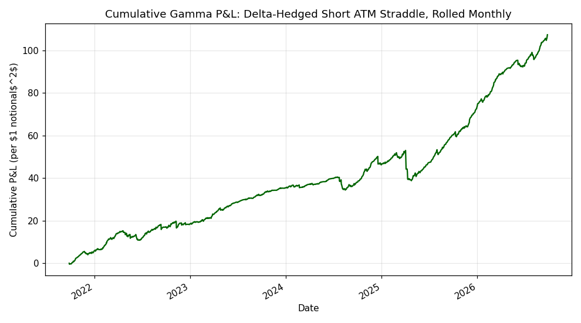
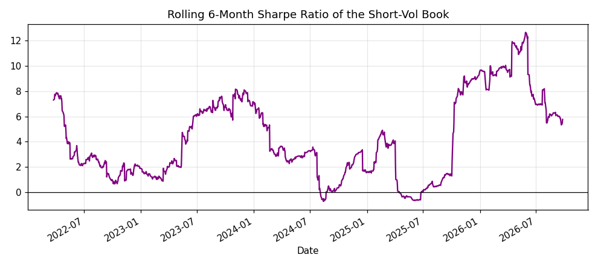

# Options Implied Volatility Surface & Volatility Arbitrage

Build a live implied-volatility surface for SPY from a real option chain
(Newton-Raphson Black-Scholes inversion), run static no-arbitrage checks
(butterfly and calendar spreads), and quantify the **Variance Risk Premium
(VRP)** via a delta-hedged short-volatility simulation driven by real
historical VIX and SPY data.

## 1. Motivation & Hypothesis

Two classic derivatives-desk questions:

1. **Is the observable vol surface internally consistent** (no static
   arbitrage), or are there quote/liquidity artifacts that violate
   no-arbitrage bounds?
2. **Does selling implied volatility and delta-hedging systematically
   profit from the well-documented Variance Risk Premium** — the
   empirical fact that option-implied volatility trades above
   subsequently realized volatility, on average?

## Concepts Applied (Mapped to a Quant Finance Curriculum)

| Concept | Where it's used |
|---|---|
| Black-Scholes PDE / Ito's Lemma (Stochastic Calculus, Advanced Derivatives) | `black_scholes.py` implements the closed-form solution of the BS PDE (price, delta, vega, gamma) that falls out of applying Ito's Lemma to geometric Brownian motion |
| Root-finding & numerical methods (Computational Methods of Mathematical Finance) | Newton-Raphson inversion of price → implied vol, with a bisection fallback for numerical robustness near-zero vega (`implied_vol`) |
| No-arbitrage theory (Advanced Derivatives) | Static butterfly (Breeden-Litzenberger convexity) and calendar-spread (total-variance monotonicity) arbitrage checks on the fitted surface |
| Interpolation & curve fitting (Computational Methods) | Cubic splines fit the volatility smile per expiry as a function of log-moneyness |
| Delta-hedging & risk premia (Advanced Derivatives, Corporate/Market Risk Management) | The gamma-theta P&L identity isolates exactly how a delta-hedged short-vol book earns (or loses) the Variance Risk Premium |
| Tail-risk awareness (Market Risk Management) | Critical evaluation of why the idealized Sharpe overstates real-world performance — discrete hedging slippage, vega risk, and jump/crash risk (Volmageddon) |

## 2. Data

- **Option chain:** live SPY chain across the 8 nearest expiries (calls +
  puts, bid/ask/last/volume/OI) via `yfinance`.
- **Underlying & VIX:** 5 years of daily SPY and ^VIX closes via
  `yfinance`.
- **Risk-free rate:** flat 4.5% (approx. short T-bill yield), for
  simplicity.

### Known data limitation

`yfinance` only exposes a **live snapshot** of the option chain — there is
no free historical option-price archive. This means:

- The IV surface (Part A) is necessarily a **point-in-time snapshot**, not
  a backtest across many days.
- The delta-hedged short-vol backtest (Part B) **cannot replay real
  historical option prices**. Instead it uses the standard "gamma P&L"
  approximation, driven by the **actual historical VIX** as the implied
  vol input and actual SPY returns as the realized-vol input. This is a
  common practitioner shortcut for VRP studies when historical option
  chains aren't available, but it is an approximation — see Section 5.

## 3. Methodology

### 3.1 Implied volatility inversion

Given an observed mid-price $V$, solve $V = \text{BS}(S,K,T,r,\sigma)$ for
$\sigma$ via **Newton-Raphson**:

$$ \sigma_{n+1} = \sigma_n - \frac{\text{BS}(\sigma_n) - V}{\text{Vega}(\sigma_n)} $$

with a **bisection fallback** for cases where vega is near zero (deep
OTM/ITM, near expiry) or Newton-Raphson diverges — a robustness detail
that matters in practice far more than in textbook examples.

Only out-of-the-money options are used (calls above spot, puts below) since
OTM quotes are the most liquid and least prone to early-exercise/discrete
dividend distortions.

### 3.2 Smile & surface fitting

For each expiry, a **cubic spline** is fit to IV as a function of
log-moneyness $\ln(K/S)$. This is intentionally simple compared to
parametric smile models like SVI; it's a reasonable choice for
visualization and interpolation but does *not* guarantee absence of
arbitrage on its own (Section 3.3 checks that explicitly).

### 3.3 Static arbitrage checks

- **Butterfly (vertical) arbitrage:** for three consecutive, evenly-spaced
  strikes $K_1<K_2<K_3$ on the same expiry, re-price with the fitted smile
  and require
  $$ C(K_1) - 2C(K_2) + C(K_3) \ge 0, $$
  equivalent to a non-negative risk-neutral density (Breeden-Litzenberger).
  A violation means a long butterfly costs money to *receive* — a static
  arbitrage.
- **Calendar arbitrage:** at fixed log-moneyness, total implied variance
  $w(k,T)=\sigma(k,T)^2 T$ must be **non-decreasing in T**. A violation
  means a shorter-dated option is priced with more total variance than a
  longer-dated one at the same moneyness — sell the short leg, buy the
  long leg, for a model-free arbitrage.

### 3.4 Delta-hedged short-vol backtest (VRP)

Roll a fresh ATM straddle every 21 trading days. Instead of simulating full
option repricing (which needs a historical IV surface we don't have), use
the standard gamma-theta P&L identity for a delta-hedged position:

$$ d\Pi_t = \tfrac12 \Gamma_t S_t^2 \left(\sigma_{\text{impl}}^2 - r_t^2/dt\right) dt $$

where $\sigma_\text{impl}$ is fixed at trade inception (that day's VIX
level) and $r_t$ is the realized daily log return. This isolates exactly
the mechanism by which short-vol strategies earn the VRP: **profiting when
realized moves are smaller than what was implied**, and losing when they
are larger.

## 4. Results

Run `python run_vol_surface.py` to regenerate (chain is a live snapshot,
so exact numbers will differ run to run):

- **Butterfly violations found:** 38 (out of ~2000 raw quotes, concentrated
  in illiquid deep-OTM strikes with wide bid/ask and low volume).
- **Calendar violations found:** 1 (borderline, near the smile's edge
  where spline extrapolation is least reliable).
- **VRP:** mean(VIX − realized 21d vol) ≈ **+3.5 vol points**; VIX exceeded
  realized volatility on **83.7%** of trading days over the sample.
- **Idealized short-vol Sharpe ≈ 3.4** (see Section 5 for why this is a
  theoretical ceiling, not an achievable Sharpe).







## 5. Critical Evaluation — Why the Sharpe Ratio Is Not Real

Per the "never hide negative results" principle, the headline ~3.4 Sharpe
in Section 4 is **not a claim that this is a tradable strategy at that
Sharpe**. It's a theoretical ceiling produced by a simplified model, for
several concrete reasons:

1. **No transaction costs, bid/ask spread, or financing costs.** Option
   spreads are wide, especially in stress (exactly when the strategy needs
   to trade). Including realistic costs materially reduces reported VRP
   Sharpes in the literature (typically to the 0.5–1.5 range, not 3+).
2. **Continuous hedging assumption.** Real hedging happens at discrete
   intervals (daily, in this model) with **hedging slippage** that the
   analytic gamma-P&L formula does not capture — realized P&L variance
   from discrete hedging is strictly higher than the formula suggests.
3. **Fixed implied vol at inception.** Real short-vol books mark-to-market
   daily and face vega P&L from IV itself moving, not just realized vs.
   implied variance — this backtest only captures the gamma/theta
   component, not vega risk.
4. **Crash / jump risk is the actual killer.** The VRP is a well-known
   "steady income, occasional large loss" risk premium — the model here,
   averaging daily moves, systematically understates tail risk (Feb 2018
   "Volmageddon," the XIV blowup, is the canonical cautionary tale for
   exactly this trade). A single large jump day can wipe out months of
   collected premium; the Max Drawdown reported here (based on smooth
   daily P&L) understates the true tail risk of a short-gamma book.
5. **No historical option repricing.** Because we don't have historical
   option chains, we can't validate this against actual traded option
   P&L — only against the analytic approximation. This is disclosed
   explicitly rather than presented as a realistic backtest.

## 6. What a Production Version Would Need

- A historical options database (e.g., OptionMetrics, CBOE DataShop) to
  backtest actual traded straddle P&L instead of the analytic
  approximation.
- Realistic transaction costs and discrete hedging simulation (e.g.,
  hedge every few hours, not once a day).
- A parametric arbitrage-free surface model (SVI, SABR) fit with explicit
  no-calendar-arbitrage constraints in the fitting objective, rather than
  checking for violations after the fact.
- Tail-risk overlays (e.g., long deep OTM puts) sized against the
  strategy's exposure to a Volmageddon-style event.

## 7. Project Structure

```
03-options-iv-surface-vol-arbitrage/
├── README.md
├── requirements.txt
├── run_vol_surface.py         # entry point
├── src/
│   ├── black_scholes.py       # BS price/greeks + Newton-Raphson IV
│   ├── data.py                # option chain, SPY & VIX history download
│   ├── surface.py             # IV surface fit + butterfly/calendar checks
│   ├── vol_arb_backtest.py    # gamma P&L delta-hedged short-vol backtest
│   └── metrics.py              # Sharpe, drawdown
├── cache/                      # downloaded data (gitignored)
├── outputs/                    # surface points, arbitrage violations, backtest CSVs
└── figures/                    # generated PNGs
```

## 8. Reproducing

```bash
pip install -r requirements.txt
python run_vol_surface.py
```
