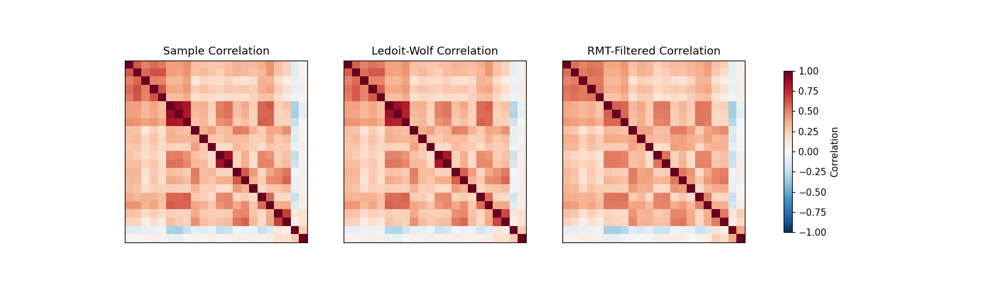
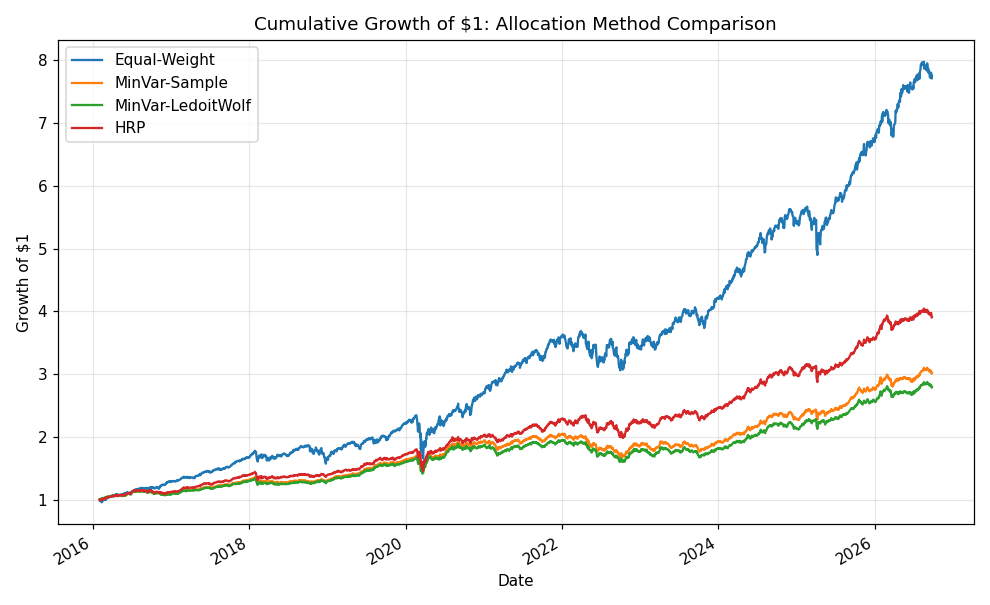
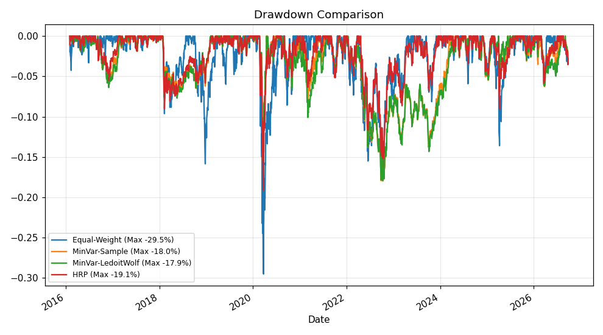
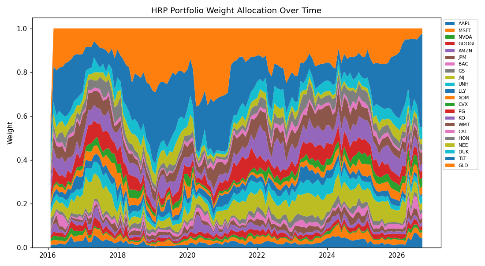
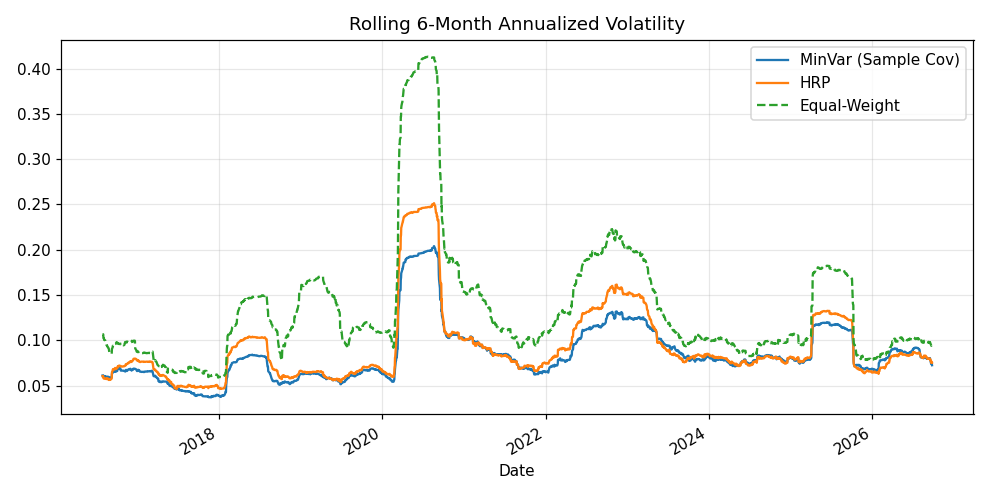

# Portfolio Optimization & Risk Modeling Framework

A comparison of classical Mean-Variance Optimization against Hierarchical
Risk Parity (HRP), with two covariance cleaning techniques (Ledoit-Wolf
shrinkage and Random Matrix Theory eigenvalue filtering), position limits,
a turnover cap, and historical VaR/CVaR risk reporting.

## 1. Motivation & Hypothesis

Markowitz mean-variance optimization is famous for being theoretically
elegant and practically fragile: it is extremely sensitive to estimation
error in the covariance matrix (and even more so in expected returns),
often producing concentrated, high-turnover, unstable portfolios
("error maximization," Michaud 1989).

> Hypothesis: a covariance-cleaning technique (shrinkage or RMT filtering)
> improves the out-of-sample stability of a Minimum-Variance portfolio,
> and Hierarchical Risk Parity — which sidesteps matrix inversion
> entirely — is more turnover-stable than Mean-Variance approaches while
> remaining risk-competitive.

## 2. Universe & Data

22 assets chosen for genuine diversification, not just more tech stocks:
5 mega-cap tech, 3 financials, 3 healthcare, 2 energy, 3 staples,
2 industrials, 2 utilities, plus **TLT** (long-duration Treasuries) and
**GLD** (gold) as diversifiers with historically low/negative equity
correlation. Daily prices, 2015–present, via `yfinance`.

## 3. Methodology

### 3.1 Covariance estimators

- **Sample covariance:** the naive MLE estimator — unbiased but very
  noisy in finite samples, especially as $N/T$ grows.
- **Ledoit-Wolf shrinkage:** linear shrinkage of the sample covariance
  toward a constant-correlation target,
  $$ \hat\Sigma = \delta F + (1-\delta)S, $$
  with the shrinkage intensity $\delta$ estimated analytically from the
  data (Ledoit & Wolf, 2004) rather than chosen by hand.
- **RMT (Marchenko-Pastur) filtering:** eigen-decompose the correlation
  matrix; eigenvalues below the Marchenko-Pastur upper bound
  $\lambda_{\max} = (1+\sqrt{q})^2$, $q=N/T$, are treated as noise and
  replaced by their average, keeping only eigenvectors associated with
  eigenvalues that exceed what pure randomness would produce.

### 3.2 Portfolio construction

- **Equal-Weight:** naive $1/N$ baseline — deliberately included because
  it is a famously hard benchmark to beat out-of-sample (DeMiguel,
  Garlappi & Uppal, 2009).
- **Minimum-Variance (Sample / Ledoit-Wolf):** solve
  $$ \min_w w^T\Sigma w \quad \text{s.t.} \quad \sum w_i = 1,\ 0\le w_i \le 0.25 $$
  via SLSQP, with the two covariance estimators above.
- **Hierarchical Risk Parity (HRP):** (1) hierarchically cluster assets by
  correlation distance, (2) quasi-diagonalize the covariance matrix in
  cluster order, (3) recursively bisect the cluster tree, splitting risk
  inverse-variance-weighted between sub-clusters. No matrix inversion is
  required, which is precisely why it is more numerically stable than MVO.

### 3.3 Constraints & frictions

- **Position limit:** 25% max per asset (MVO only; HRP and EW naturally
  diversify).
- **Turnover cap:** rebalancing trades are scaled down if one-way turnover
  would exceed 30% of the book in a month.
- **Transaction costs:** 10 bps per unit of turnover.
- **Rebalancing:** monthly, using a trailing 252-day (1-year) estimation
  window — an explicit bias-variance tradeoff (longer windows are more
  stable but more stale).

### 3.4 Risk reporting

Beyond Sharpe/volatility/drawdown, historical (non-parametric) **95% VaR**
and **95% CVaR** are reported for each strategy's daily returns — CVaR in
particular is the more decision-useful tail-risk number since it averages
the realized losses beyond the VaR threshold rather than just reporting
a single quantile.

## 4. Results

Run `python run_portfolio.py` to regenerate:

**Ledoit-Wolf shrinkage intensity ≈ 0.05** (small — with 22 assets and a
252-day window, N/T ≈ 0.087, so the sample covariance isn't catastrophically
noisy, but still benefits from a small nudge toward the structured target).

**RMT: only 4 of 22 eigenvalues** exceed the Marchenko-Pastur noise
threshold — i.e., the framework judges that ~82% of the correlation
matrix's eigen-structure is statistically indistinguishable from random
noise, consistent with the well-known empirical finding that equity
correlation matrices are dominated by 1 market factor + a handful of
sector factors, with the rest being estimation noise.

| Strategy | Ann. Return | Ann. Vol | Sharpe | Max DD | Avg Monthly Turnover |
|---|---|---|---|---|---|
| Equal-Weight | 21.3% | 15.1% | ~1.4 | see fig 3 | 0.4% |
| MinVar (Sample Cov) | 10.9% | 9.0% | ~1.2 | see fig 3 | 7.4% |
| MinVar (Ledoit-Wolf) | 10.1% | 9.0% | ~1.1 | see fig 3 | 6.7% |
| HRP | 13.7% | 10.1% | ~1.4 | see fig 3 | 10.3% |







## 5. Critical Evaluation — Where Each Method Falls Short

1. **Equal-Weight "wins" on raw return, but that's a bull-market
   artifact, not a risk-adjusted victory.** 2016–2026 was dominated by a
   historic mega-cap tech rally; $1/N$ has maximum exposure to exactly
   that. Its Sharpe is competitive with HRP mainly because the sample
   period's realized correlations happened to be benign — this would not
   hold in a sustained tech drawdown, and the higher volatility/drawdown
   profile (see Fig. 3) is the honest cost of that concentration.
2. **Ledoit-Wolf shrinkage barely changes results here.** With shrinkage
   intensity ≈0.05, the shrunk and sample covariance MinVar portfolios are
   nearly identical (10.1% vs 10.9% return, same vol) — shrinkage matters
   far more when $N/T$ is larger (more assets, shorter history) than in
   this 22-asset, 10-year setup. This is itself a useful negative
   result: **don't expect shrinkage to transform results if your sample
   isn't actually noise-dominated.**
3. **HRP has the highest turnover, not the lowest.** The hypothesis that
   HRP is more turnover-stable than MVO is **not confirmed** in this
   backtest (10.3% vs 6.7–7.4% for MinVar). This is because HRP's cluster
   structure can shift discretely between rebalances as correlations
   drift, causing the recursive bisection to reallocate more aggressively
   at cluster boundaries — a genuine limitation worth flagging rather
   than asserting HRP is strictly better on all dimensions.
4. **RMT filtering is not evaluated in the return backtest.** It's shown
   only as a covariance-cleaning diagnostic (Fig. 1) — a full backtest
   using the RMT-filtered covariance in the optimizer was out of scope
   for this simple version; a natural next step (see Section 6).
5. **Position limits mask concentration risk in MinVar.** The 25% cap is
   doing real work — an unconstrained MinVar would likely concentrate
   further into low-vol defensives (TLT, staples, utilities), which is
   exactly the estimation-error sensitivity Markowitz optimization is
   famous for.

## 6. What a Production Version Would Need

- Full backtest of the RMT-filtered covariance portfolio alongside the
  others.
- Black-Litterman with real, sourced analyst views (implemented in
  `src/optimizers.py::black_litterman_posterior` but not wired into the
  backtest here) rather than an equilibrium-only prior.
- Explicit CVaR-constrained optimization (not just CVaR *reporting*) —
  e.g., minimize CVaR subject to a return target, solved as a linear
  program (Rockafellar & Uryasev, 2000).
- Out-of-sample walk-forward validation with multiple lookback windows to
  check sensitivity to the bias-variance tradeoff noted in Section 3.3.

## 7. Project Structure

```
04-portfolio-optimization-risk-framework/
├── README.md
├── requirements.txt
├── run_portfolio.py         # entry point
├── src/
│   ├── data.py               # yfinance multi-asset price download
│   ├── covariance.py         # sample, Ledoit-Wolf, RMT covariance estimators
│   ├── optimizers.py         # MinVar/MaxSharpe (SLSQP), HRP, Black-Litterman
│   ├── backtest.py           # rolling monthly rebalance, turnover cap, costs
│   └── metrics.py             # Sharpe, drawdown, VaR, CVaR
├── cache/                     # downloaded data (gitignored)
├── outputs/                   # performance_summary.csv, avg_turnover.csv
└── figures/                   # generated PNGs
```

## 8. Reproducing

```bash
pip install -r requirements.txt
python run_portfolio.py
```
